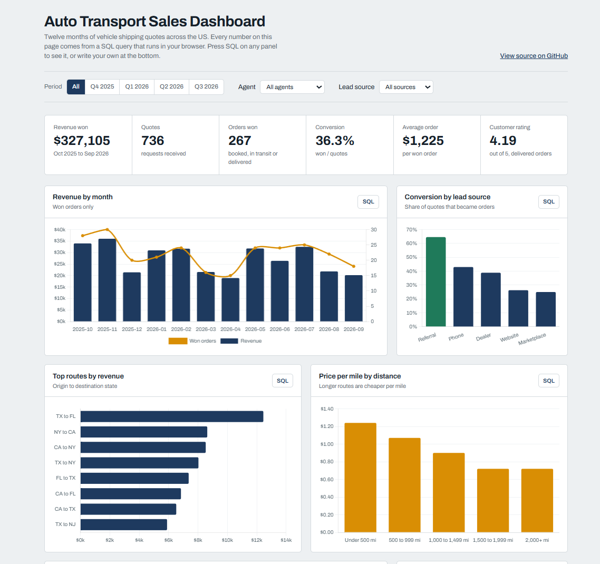

# Sales Dashboard

A year of vehicle shipping quotes (Oct 2025 to Sep 2026), shown the way I would have wanted to see them when I was selling: revenue by month, which lead sources actually convert, which routes pay, how price per mile drops on long routes, how each agent is doing, and an ABC analysis of routes.

Every number on the page comes from a SQL query that runs in the browser. Press **SQL** on any panel to see it, or write your own in the explorer at the bottom.

**Demo:** https://teodor-ninkov.github.io/sales-dashboard/



## How it works

- `data/orders.csv` (736 quotes) and `data/agents.csv` (teams and monthly targets) are loaded into an in-memory SQLite database with [sql.js](https://github.com/sql-js/sql.js).
- The filters (period, agent, lead source) become a `WHERE` clause that is added to every query.
- Charts are drawn with Chart.js. All queries are also in `sql/queries.sql`.

The data is generated, but shaped on what I saw in real auto transport sales: referrals and phone leads convert far better than marketplace leads, and long routes are cheaper per mile.

## ABC analysis

Routes are ranked by revenue and split by their share of the running total: A routes make the first 80% of revenue, B the next 15%, C the last 5%. It is done in one query with window functions (`SUM() OVER (ORDER BY revenue DESC)` for the running total, `SUM() OVER ()` for the grand total), and it follows the filters, so you can see a single agent's A routes.

In this data A routes are more than half of all routes, which is less extreme than the usual 20/80 rule. That is what happens when demand is spread across many state pairs, and it is a useful thing to notice rather than force into the textbook shape.

## Problems I hit

- **No backend on GitHub Pages.** I wanted real SQL, not JavaScript pretending to be SQL. sql.js runs SQLite as WebAssembly, so the whole database lives in the page.
- **Wrong folders after uploading through the browser.** The page loads `data/orders.csv`, and uploading files one by one flattened the folders and broke it. Keeping the paths fixed was the fix.
- **One table was not enough to practise joins.** I added `agents.csv` with teams and targets, so the explorer has JOIN and CTE examples (revenue by team, months each agent hit target).

## Run locally

```bash
python -m http.server 8000
```

Then open http://localhost:8000. Opening the file directly will not work, because the page fetches the CSV files.
